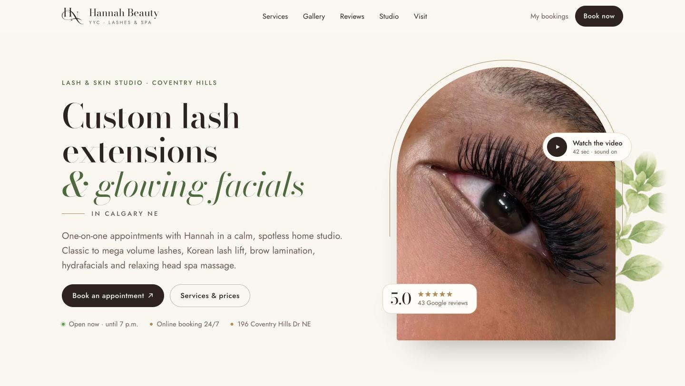

# Hannah Beauty YYC — website

**Live site:** [hannahbeauty.ca](https://hannahbeauty.ca) 
**Client:** lash and skin studio in Coventry Hills, Calgary NE 
**Built at:** Alpha Seed Inc. (part-time) 
**My role:** design and build, domain and email setup, search setup, after-launch support

> The source code is private client work. This repo shows what the site does and how I built it.

## What the site does

- One page covering services and prices (lash extensions, lash lift and brows, facials and head spa), a gallery of real lash sets, client reviews, the studio, policies and FAQ, and hours and location.
- "Book now" and "My bookings" open the studio's Square Appointments page, so clients can book online 24/7.
- Short video clips from the studio.

## How I built it

1. **Design and build:** HTML and CSS with AI-assisted development (Claude); responsive layout for phones and desktops.
2. **Domain, DNS and SSL:** registered the domain, set up DNS, and serve the site over HTTPS through Cloudflare.
3. **Business email:** Google Workspace with MX, SPF, DKIM and DMARC records, so email from the domain lands in inboxes instead of spam.
4. **Search and Google:** page title and description, `BeautySalon` and `VideoObject` structured data (schema.org), and the Google Business Profile.
5. **After launch:** fix issues and walk the owner through changes by phone or remote session, in English or Vietnamese.

## Tools

HTML · CSS · Cloudflare · Google Workspace · Square Appointments · schema.org
